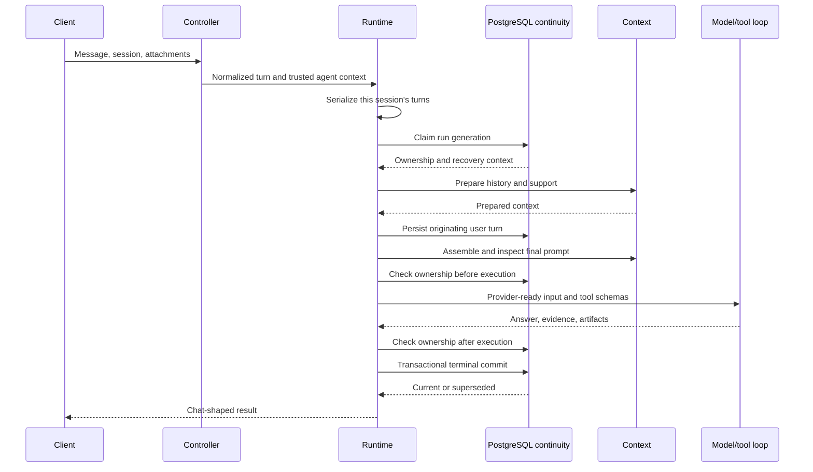
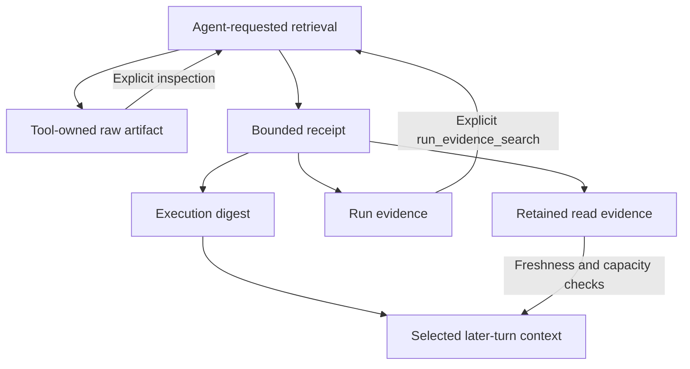

# Runtime and context construction

!!! warning "Earlier technical reference"
    This page is retained from earlier documentation and has not been fully revalidated for the public 2026.10.19 release. Its revision-specific links and examples may describe older or development behavior. Start with the [current operator guide](../guide/installation.md); do not use this page alone to select installation commands, image tags, or security settings.

A normal chat turn is coordinated by `runAskChat`. Its contract requires a root, a message, and composed PostgreSQL application stores. Transport adapters supply trusted agent context separately from serialized request arguments.

## Turn lifecycle

The source order includes support preparation before early user-turn persistence, then final prompt assembly and execution. Recording the originating instruction before model/tool work makes interrupted work attributable. Peer delivery already persisted its attributed ingress and is not duplicated as an operator message.

## Session ownership and stale results

A per-session in-process queue prevents simultaneous operator turns and nested replies from invalidating each other within one process. PostgreSQL continuity heads and transactional ownership checks protect cross-process completion.

The runtime checks ownership before starting model work and again afterward. Terminal finalization runs through a continuity commit. If ownership changed, the result is `superseded`, the stale answer is not published as current, and a compact recovery manifest records the need to reconcile durable state. This guards terminal persistence; it cannot undo a tool's already-completed external effect.

In public release `2026.10.19`, `continuity_state` owns the head, interruption manifest, and recovery queue; `continuity_log` records changed snapshots. Indexed state columns support active/pending recovery selection. Session-list compatibility can still expose a joined head, but ordinary session metadata is no longer the storage authority for those records. See [Persistence recovery](persistence.md#runtime-continuity-and-crash-recovery) and [Storage schema](../reference/storage-schema.md#conversations-and-original-evidence).

### Newer development cancellation and reset handling

The inspected development build **2026.10.21.2** reports aborted but still registered runs as `cancelling`, closes steering for them, and introduces reset admission generations. Queued work from a superseded generation fails before execution; new work waits behind the reset barrier. A cancellation deadline releases admission only after durable fencing succeeds. These changes are newer than public **2026.10.19** and do not undo external effects already performed.

## Context preparation is a first-class boundary

ContextBuilder consumes a versioned prepared envelope. Normal preparation reads canonical conversation state, considers compression, and verifies that selected history is covered rather than silently dropping uncovered turns. It can rebuild after compression before assembling the final provider request.

Important failure categories include uncovered history, unavailable compression, and an assembled prompt that remains over budget. Exact behavior of exceptional branches and the estimate's limits are tracked in [Known limitations](../project/known-limitations.md).

### Provider-ready order

The provider-facing message projection separates:

1. Identity/profile system material
2. Stable operating instructions
3. Support context, with provenance
4. Prior conversation summary
5. Recent role-preserving dialogue
6. The current user instruction

This is different from the flattened diagnostic prompt and from the broad section names in the runtime contract. Prior summaries are support for continuity, not replacement source evidence. Attributed peer messages preserve their origin instead of masquerading as user instructions.

### Budgets and current-message integrity

The current message is atomic. Context handling may reduce older dialogue and lower-priority support, but does not silently cut the current instruction to an arbitrary character limit. Profiles, skills, attachments, summaries, and evidence projections have their own bounds.

The final request is inspected against configured model capacity. The estimate is not an exact tokenizer and does not account equally for every transport field. Treat it as a pressure signal; see [Models](../concepts/models.md#context-capacity-and-the-meter).

## How evidence returns to later turns

These mechanisms solve different problems:

- **Execution digest:** a bounded account of important tool outcomes for continuity
- **Run evidence:** compact objective/outcome/target records retrieved explicitly through `run_evidence_search`; current pre-turn support does not automatically inject historical run proof
- **Read evidence:** retained excerpts with source range and freshness metadata
- **Raw artifacts:** detailed output available for explicit inspection

Run evidence is bounded to 32 records and 14 days in its helper. Read evidence is bounded to 12 items/64 KiB and checks size/mtime before reuse; it does not revalidate a content hash. Neither mechanism grants action authority.

For the complete continuity model, read [Memory](../concepts/memory.md) and [Conversation history](../concepts/conversation-history.md).

## Planning and compatibility

An optional configured planner can return structured intent/support information. Without that planner, fallback labels derive from explicit transport controls. Normal chat still uses a model-owned tool loop; planner metadata is not an automatic worker spawn or authorization decision.

Explicit work-item continuation takes a retained compatibility branch. The public `runBurrow` entrypoint is also a declared compatibility adapter around proposal, verification, and commit logic. Do not assume its gates are the normal-chat execution path.

## Restart recovery

Graceful interruption writes compact runtime-owned manifests, then aborts active runs. Recovery considers a bounded same-session transcript and requires a reliable objective. It chooses `resume`, `reconcile_first`, or `needs_user_input`. Pending recovery continuations are durably claimed before work begins.

Recovery is therefore reconciliation, not blind replay. It must inspect already-completed effects and pending verification before repeating actions.

## Targeted source review

Corrections on this page were checked against public **2026.10.19**; any newer development behavior is labeled separately. This was static source inspection, not a live deployment test. Other retained details remain subject to the earlier-reference warning.

- [backend/src/app-runtime.mjs](https://github.com/GoblinKing-Burrow/Burrow/blob/aa5a30da683a3a8ea919025f107ff53f182ef8d6/backend/src/app-runtime.mjs)
- [backend/src/session-admission.mjs](https://github.com/GoblinKing-Burrow/Burrow/blob/aa5a30da683a3a8ea919025f107ff53f182ef8d6/backend/src/session-admission.mjs)
