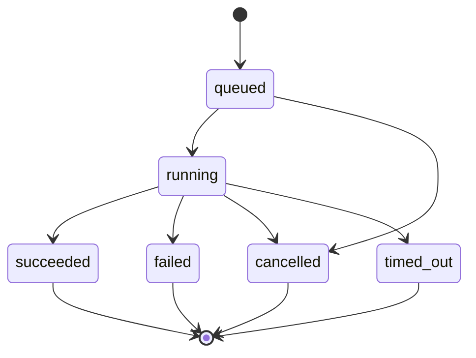

# Agents and minions


!!! warning "Earlier technical reference"
    This page is retained from earlier documentation and has not been fully revalidated for the public 2026.10.19 release. Its revision-specific links and examples may describe older or development behavior. Start with the [current operator guide](../guide/installation.md); do not use this page alone to select installation commands, image tags, or security settings.


Use a registered agent for a persistent identity and configuration. Use a minion for an explicit child task. Use peer messaging when one registered agent needs another agent's response in that recipient's own context.

## Registered agents

An agent record supplies an ID, display name, enabled state, available capabilities, context configuration, and optional execution-environment assignment. IDs are validated; a display name is not a replacement for durable identity.

Agent workspace/data roots are derived from the runtime workspace root and agent ID. The runtime creates `skills`, `sessions`, `artifacts`, and `tools` directories below that root. Directory existence does not mean those directories own conversation persistence: current conversation authority is PostgreSQL.

### Profile and model context

Profile documents provide identity, rules, orientation, tool/environment facts, preferences, and configured continuity. They are loaded for the selected agent. A missing profile must not silently substitute another agent's profile. Models are selected from configured connections; a child can request a different enabled model without changing its parent's selection.

The inspected development build **2026.10.21.2** also adds optional global `RULES` and `ORIENTATION` content. An agent opts into each global document separately; enabled global text is prepended to that agent's own document. This is not part of public **2026.10.19**.

See [Initial setup](../getting-started/initial-setup.md), [Models](models.md), and [Persistence](../architecture/persistence.md).

### Execution environment

An agent can use local execution or a registered remote provider/target assignment. The assignment chooses where supported process/filesystem operations run. Controller-owned conversation and configuration state remain separate from that execution host.

Legacy provider-less `gateway` assignments are normalized to unresolved data rather than guessed into a provider. Repair an unresolved assignment through the supported settings flow. This documentation does not cover provider-specific remote mods.

## Minions: explicit child work

The native `spawn_subagent` tool requires:

- `task`: the full instruction
- `target.kind`: `filesystem`
- `target.root`: an absolute path to an existing directory

Optional fields include a short `label` and an exact configured `model` ID. When omitted, the runtime uses the agent's configured Minion model selection if present, otherwise the parent selection. An explicit model ID resolves on the parent's connection. Tool-schema examples below illustrate agent tool arguments, not shell commands or HTTP request bodies.

```json
{
  "task": "Inspect the parser and its tests. Report concrete edge cases with file references; do not modify files.",
  "label": "Review parser",
  "target": {
    "kind": "filesystem",
    "root": "/srv/projects/example"
  }
}
```

The target is validated before dispatch. Local wrapper directories may be refined to a nested `repo` directory when only that directory has repository signals. The receipt records the resolved target; use it when interpreting results.

### Minion Depth

Current development has an independent per-agent **Minion Depth** setting, default **1**:

| Depth limit | Work permitted from the root (depth 0) |
|---|---|
| `0` | No child spawning |
| `1` | Direct children only; children are leaves |
| `2` | Children may spawn grandchildren; grandchildren are leaves |

At a leaf, `spawn_subagent` is absent from the tool surface and the executor independently rejects a manually requested spawn. This is a nesting ceiling, not a fan-out control or a per-spawn argument. Saving or clearing the separate Minion model selection does not change depth. Use the [Minion settings API](../reference/api/settings.md#minion-depth) for the request contract.

Child ancestry and its spawn-time budget persist. Reopening a child does not turn it into a root; historical direct children without a marker remain depth 1 with budget 1. The current agent setting can tighten the effective spawning budget, but raising it does not enlarge a child's saved lineage budget.

### What a minion receives

A child starts with a purpose-built prompt containing its task and working directory. It runs its own model/tool loop and does not receive the full parent conversation as a cloned transcript. Its standard tool surface includes filesystem, shell and Git tools; nested spawning is available only while the depth budget permits it. It excludes the server-owned Forge dispatcher.

Local minions use a separate Node process. A remote-assigned minion uses the child runner in-process so it can preserve the trusted remote execution controller. Both have separate child-session lineage and receipts.


!!! warning "Isolation is about session/process context"
    A minion target is not a filesystem cage. An instruction such as “do not modify files” communicates task scope, but the target directory does not remove mutation tools. Configured execution boundaries are forwarded into child review and execution; they retain the limited enforcement scope described in [Permissions](../security/permissions.md#minion-boundary-propagation).


### Completion and evidence



These are the contract's allowed statuses; they do not imply that every dispatcher implements a timeout policy. The current local process runner has no overall task-deadline timer; its cancellation grace timer only forces cleanup after an abort.

The child must call `finish_subagent` with `status` and `summary`. Optional structured verification distinguishes `passed`, `failed`, `failed_expected`, and `not_run`. Ordinary prose is not a terminal completion signal. `finish_subagent` must be the sole call in its batch; mixed terminal/action batches are rejected without executing their requested actions. Repeated unchanged tool calls can stop with `subagent_repeated_no_progress`. If the child stops calling tools without finishing, the runtime asks once for a structured final report; failure to provide it becomes a failed result.

The parent receives bounded evidence, a summary, resolved target, lineage, and receipt references. Changed files, artifacts, memory writes, and all-run consequences are now aggregated even when older tool receipts leave the retained window; `omittedToolResults` reports omitted receipts. `sideEffectsApplied` is true for observed mutations, false for known non-mutating outcomes, or null when effects are uncertain. Large raw outputs belong to trace artifacts. Inspect actual receipts when side effects matter.

Identical structural spawn requests within the same parent lineage can reuse an existing record. This is mechanical deduplication, not semantic task matching. The identity includes the requested model, resolved model and connection, and model profile, as well as parent lineage, target and normalized task. A guarded claim makes exact retries reuse existing records across all statuses, including failed or in-flight work. Inspect `reused` and the resolved-model receipt.

## Peer agent messages

`agent_send_message` addresses another registered agent by canonical ID (preferred) or unique full display name, optionally choosing its recipient session. Exact IDs take precedence; otherwise existing ASCII case-insensitive ID/name matching applies. There is no fuzzy recipient selection, and unknown or ambiguous names fail without sending. Messages are stored as attributed `agent` turns in both conversations; they are not impersonated operator messages.

For an unknown or ambiguous peer, use Core-native `agents_list`. No Backdoor skill, MCP catalog lookup, health probe or peer-session inspection is needed for ordinary A2A. A known unambiguous peer can be messaged directly.

The directory returns only exact `{id, name, enabled}` cards, with enabled agents by default. Optional `query` matches case-insensitive ID/name substrings; `includeDisabled: true` includes disabled identities. `limit` is 1–20 (default 20); follow `nextCursor` with unchanged filters until null. `totalCount` describes the filtered directory. If the registry changes, restart the listing. If provider-context projection reports omitted cards, narrow the query or page before advancing. Directory membership is not a health check or permission to inspect peer data.

| Mode | Behavior |
|---|---|
| `deliver` | Persist an attributed FYI without executing a recipient reply |
| `request_reply` | Execute one recipient response and mirror the response back; the sender may deliberately message again |
| `request_reply_complete` | Execute one recipient response, mirror it back, and remove peer messaging from the sender's continuation tool surface |

The default mode is `request_reply`. Current Core routes new implicit deliveries to `default` when the recipient's **A2A in default** preference is on (the default), or to `a2a` when off. Explicit target sessions and runtime-attested reply routes take precedence; changing the preference does not redirect an exchange already in flight. Self-send is rejected. Concurrent reply requests to the same recipient session are serialized, and wait-graph cycles are rejected before new transcript ingress. Reply-mode deliveries use durable claims to reuse terminal results on exact retries rather than wake the recipient twice; cancellation is checked before queued ingress and execution.

```json
{
  "recipientAgentId": "reviewer",
  "targetSessionId": "design-review",
  "messageMode": "request_reply_complete",
  "content": "Review the proposed interface and return your conclusion with any blockers."
}
```

### Dedicated inbox history

When **A2A in default** is off, current Core can rotate a named inbox's visible history before a new safely admitted reply exchange. It waits when another exchange or family recovery is open; followups and retries do not rotate again. Originals remain archived. Default history, runtime-attested returns and FYI-only deliveries are not rotated. This is lazy exchange lifecycle, not a TTL; unresolved exchanges can retain visible history indefinitely. See [operator guidance](../guide/everyday-use.md#dedicated-a2a-visible-history).

## Group conversations

A group room is a shared operator transcript over separate registered-agent runs. Each selected participant executes in its own agent-scoped `group-<channelId>` session, retaining that agent's identity, tools, memory scope, and continuity owner. A room does not combine participant grants or replace their individual contexts.

Explicit request recipients take precedence over recognized participant `@` mentions. With neither, the server broadcasts to every room participant. Unknown mentions reject the message; addressing uses participant IDs or names, with case-insensitive matching. The server launches selected participants asynchronously from the same captured room history, then appends attributed replies. Acceptance lists the launched runs; inspect each participant's outcome rather than treating it as a collective success. Each active participant run can be cancelled separately.

Use [Interface groups](interface.md#attachments-and-groups) for room controls and the [API reference](../reference/api.md) for request and cancellation endpoints.

## Watching and stopping work

Active peer runs expose bounded progress. Stopping an A2A parent cancels its active nested reply tree. Local minion process cancellation sends `SIGTERM` to the process group, then forces `SIGKILL` after a configurable grace (default one second); cleanup also handles remaining descendants and removes the temporary payload. This cancellation grace is not a wall-clock task timeout. Current status projects the requested session and its descendants, not an arbitrary capped child list. Recent completed children normally remain visible for one hour; an ended ancestor can remain to connect a visible descendant. Immediate parent, root and depth are separate fields. A child-scoped query excludes siblings; overview context hydration is separately bounded to the requested session plus 12 descendants. Durable receipts remain separate from visibility.

See [Interface](interface.md), [Observability](../operations/observability.md), and [Execution flow](../architecture/execution-flow.md).


## Targeted source review

Corrections on this page were checked against public **2026.10.19**; any newer development behavior is labeled separately. This was static source inspection, not a live deployment test. Other retained details remain subject to the earlier-reference warning.

- [backend/src/config.mjs](https://github.com/GoblinKing-Burrow/Burrow/blob/aa5a30da683a3a8ea919025f107ff53f182ef8d6/backend/src/config.mjs)
- [backend/src/subagent-spawn-execution.mjs](https://github.com/GoblinKing-Burrow/Burrow/blob/aa5a30da683a3a8ea919025f107ff53f182ef8d6/backend/src/subagent-spawn-execution.mjs)

## 29 October development delta

Changed contracts above were checked statically against Backend `4057b50a5d5a9b14d36bb3b70f35781c4b29a9b9` on **2026-10-29**. This is not a runtime, provider or collector test, nor a revalidation of unchanged historical sections. See [source coverage](../project/source-map.md).
