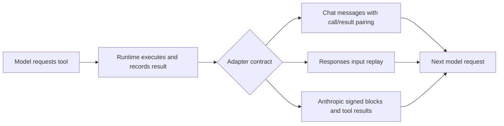

# Models and providers

!!! note "Source review and historical material"
    This technical reference was reconciled statically with current implementation on **1 November 2026**. Explicit historical examples, screenshots and pinned public links remain historical; they are not evidence of current runtime acceptance. Start with the [current operator guide](../guide/installation.md) for installation and check your installed build before using newer capabilities.

Model selection is explicit configuration. A connection describes the provider endpoint and credential source; a model identifies the configured capability to use through that connection. The connection ID is durable identity. A display label is presentation.

Configure and enable the connection/model, then select it for an agent. Do not put application model settings in a new `burrow.json` file or edit an immutable release to change an agent's selection. See [Initial setup](../getting-started/initial-setup.md) and [Configuration](../reference/configuration.md).

## Choose and save a model in the UI

Use **Settings → Connections → Models** to Connect, inspect discovery results, check the models to use, and Save. Model names open capability details; the checkbox enables the model. Manual Model ID entry is available after Connect, including when discovery fails. Follow the [step-by-step connection and OpenAI sign-in guide](../getting-started/initial-setup.md#configure-a-usable-model).

Then select the agent in **Chat** and use the **Provider** and **Model** toolbar controls. **Effort**, supported **Thinking** mode, and **Temp** also persist with that agent's selection. Changing provider/model may reset effort to that model's default. The backend checks that the model is enabled and the connection has authentication. A UI temperature choice is not a promise that the adapter sends temperature: GPT-6.1, ChatGPT backend requests, and other models marked as not supporting it omit the field.
## Supported adapter paths

| Path | Role | Important behavior |
|---|---|---|
| OpenAI-compatible Chat Completions | Conversational model requests | Role-structured messages and native tool calls/results |
| OpenAI Responses | Conversational model requests | Responses input items and replayed native continuation context |
| Anthropic Messages | Conversational model requests | Content blocks, signed thinking preservation, tool-use/result pairing |
| Google Gemini Developer API | Native chat/streaming and tool continuation | Uses the Google API contract, not an OpenAI-compatible endpoint |
| OpenAI LB / Anthropic LB | Logical same-family OAuth account pools | Current text-model routing with eligibility, sticky ownership and bounded pre-output retry; see [account pools](../guide/models.md#native-oauth-account-pools) |
| Generated-artifact adapter | Output-only image/audio generation | Current user generation instruction, without the full conversational prompt or tool loop |
| Google Lyria | Forge music generation | Separate generation dispatch path, not a chat transport |

Adapter selection is based on configured API/capability, not a promise that every remote endpoint implements every feature. 

### Choosing an API contract

Use the contract actually supported by the provider and model. “OpenAI-compatible” does not automatically imply identical streaming events, tool-call behavior, token limits, or generated-media support.

The OpenAI adapter builds endpoints from the configured base URL/API mode. Recognized ChatGPT backend endpoints have a dedicated Responses request shape: streaming enabled, storage disabled, and unsupported sampling/output-limit fields removed. This is a source-specific compatibility path, not permission to substitute arbitrary credentials between services. 

For a new connection, first validate a simple answer, then a harmless tool call, then any required image or continuation behavior. A plain-text success does not establish complete tool compatibility.

## Credentials and acquisition

Credential type and acquisition flow are different:

- A connection may use an API key, token, or supported OAuth material
- A login/import helper obtains credentials for a supported connection flow
- The provider adapter consumes the resolved credential; it does not make the UI the credential store

The Claude Code helper wraps the installed CLI's `claude auth login --claudeai` flow in a scratch home, tracks status, and supports import/cancellation cleanup. It is not a separate credential type or a model execution engine. See [Authentication](../security/authentication.md) for operator and provider credential boundaries. 

## Vision and generated output

Image attachments become multimodal content only when the selected model/adapter advertises vision support. The current user message receives the image parts; historical user turns are not all rewritten as image prompts. Without vision, the runtime supplies a textual notice describing the limitation rather than pretending to inspect pixels. 

Output-only generators receive the current generation instruction and adapter-owned generation options. They do not receive the assembled profile, history, memory, tools, or a conversational follow-up. Generated sources must be persisted before attachment metadata enters the assistant transcript.  

Use [Forge jobs](workers-tasks.md#background-maintenance-and-generation) when generation should be tracked asynchronously. A listed preview model is a configured compatibility entry, not evidence that the provider currently makes it available to the account.

## Reasoning, sampling, and caching

Reasoning/thought deltas are separate from answer text. Clients must not concatenate them into the final answer or durable assistant message.

Current Anthropic selections separate **Thinking** mode from **Effort**. Native catalogue capabilities take precedence, including explicit unsupported values; conservative checked-in fallbacks support known models on older catalogues/proxies. Unknown models offer provider default unless native metadata declares more. Discovery follows declared catalogue pages and fails an invalid or incomplete pagination chain instead of accepting its first page as a complete refresh. Native capability provenance remains distinct from optional catalogue enrichment.

| Thinking selection | Request behavior |
|---|---|
| Default | Omits `thinking`; uses the provider's default |
| Disabled | Sends `thinking.type: disabled` only where supported |
| Adaptive | Sends `thinking.type: adaptive`; effort is independent |
| No up-front thinking | Sends `thinking.type: between_tools`; supported combinations are limited to High effort or lower |
| Manual | Sends `thinking.type: enabled`; default budget is 8,000 tokens, bounded below the total request allowance |

Effort **Default** uses the stored `off` sentinel but omits native effort; it does **not** turn thinking off. Explicit native effort names are preserved (`xhigh` is not silently mapped to `max`). Unsupported mode/effort combinations fail validation rather than changing operator intent.

A saved `thinkingMode: null` is a **legacy effort-based selection**, not provider default. Legacy Off resolves to Disabled; if the model cannot disable thinking, deliberately select a supported mode before running it. Saving the same model without a mode retains its previous mode; changing models with the mode omitted resets to legacy. Explicit `default` chooses provider defaults. Main and Minion selections preserve this distinction, and the full logical turn snapshots mode and effort for its tool continuations.

Prompt caching is enabled by default unless explicitly disabled. Unsupported or new model names still require validation; source compatibility metadata is not proof of live account availability.  

### What caching currently means

There is no prompt-cache switch, retention selector, cache-key field, or cache-clear button in the model-provider UI. Do not treat an adapter configuration option as an operator-facing control.

- **Anthropic:** the adapter enables prompt caching by default. It adds `cache_control: { type: "ephemeral" }` to the final system block and final tool definition, when present. It does not add message-history cache breakpoints or request an explicit TTL. At the adapter level, `anthropicPromptCaching: false` or `promptCaching: false` disables those annotations; the standard connection editor does not expose these flags.
- **OpenAI-compatible requests:** the normal request builder does not generate a `prompt_cache_key` or request cache retention. It can merge internal `config.extra` fields, but the standard model-connection UI is not an editor for those fields. Provider caching is not guaranteed by saving a connection.
- **ChatGPT/Codex backend:** the adapter sends session/thread affinity headers when identifiers are available, and reuses a returned turn-state token within that adapter instance. This is separate from public API caching and is not a promise of cross-run cache hits.
- **Diagnostics:** provider-reported cached-token usage is evidence of reuse for a response. Stable-prefix hashes and wire fingerprints help compare request content; matching hashes alone do not prove a cache hit. A fingerprint's `cacheIdentity` can be the hash of an absent/null key.
## Tool continuations

OpenAI Responses continuations replay prepared context rather than relying on `previous_response_id`. Anthropic preserves opaque signed thinking blocks when continuing a tool exchange; a signature-specific rejection can trigger one retry without those thinking blocks. Tool arguments/results still need valid pairing and a supported provider contract.  

## Context capacity and the meter

The runtime selects and compresses context before calling a model. The current message is kept intact; lower-priority material is reduced, or a request that still cannot fit is rejected.

!!! note "The meter is an estimate"
    Character-based estimates and image allowances are not a provider tokenizer. Some schema and wire fields are not fully represented in the current adapter estimate. Provider telemetry can refine the display, and a run keeps its high-water mark. Do not use the meter as an exact billing count or a guarantee that a provider will accept a request at the advertised limit.

Inspect the current session with `/context` and the redacted provider-ready request with `/context full` where supported by the chat transport. See [Observability](../operations/observability.md), [Runtime architecture](../architecture/runtime.md), and [Known limitations](../project/known-limitations.md). 

## Failure interpretation

When diagnosing a failed turn, separate connection/authentication failure, model selection failure, unsupported request options, context pressure, stream interruption, tool failure, and missing final synthesis. Preserve the actual error and run ID. Avoid testing with a costly generation request when a harmless text or read-only tool check can establish the broken layer.

Streaming completeness checks differ by adapter, and bounded transport handling is not a blanket guarantee that every truncated provider stream is marked failed. The central [limitations](../project/known-limitations.md) record the source-level caveats; [Troubleshooting](../operations/troubleshooting.md) provides operator procedures.

## Explicit model selection after API discovery

For ordinary API-key connections, newly discovered model IDs start unchecked. Select at least one before saving; rediscovery preserves existing selections and leaves newly found IDs unchecked. OAuth and Load Balancing discovery retain their existing behavior. This editor opt-in does not redefine pool catalog intersections or disable pool routing through an account checkbox.

Provider quota indicators and their polling were removed from the bottom status bar. OpenAI LB aggregate request/token statistics remain a separate feature; this UI removal does not disable provider-pool capacity routing.
