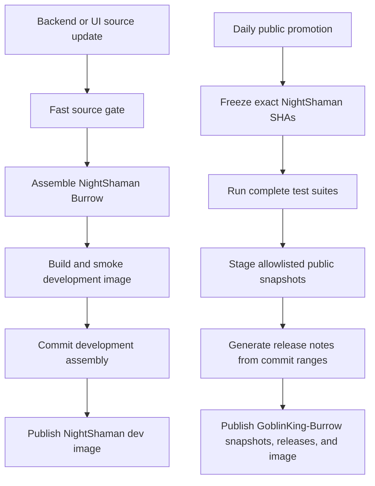

# Releases

!!! warning "Earlier technical reference"
    This page is retained from earlier documentation and has not been fully revalidated for the public 2026.10.19 release. Its revision-specific links and examples may describe older or development behavior. Start with the [current public-release user guide](../guide/installation.md); do not use this page alone to select installation commands, image tags, or security settings.

NightShaman repositories are the development authority. Development pushes use fast contract/build gates, update the assembled NightShaman Burrow tree, and publish immediately testable development artifacts. They do not replace the completely validated public releases.

The scheduled `Validate and promote public releases` workflow is the release boundary. It freezes exact NightShaman revisions, runs complete validation against that frozen set, stages allowlisted public trees, and then publishes coordinated releases to `GoblinKing-Burrow`.

## Pipeline flow

The development assembly serializes publishers, verifies exact Backend and UI source checks, builds the UI, copies the allowlisted runtime payload, writes `SOURCE_VERSIONS`, builds the container, and runs the packaged-runtime smoke test. It then publishes the exact tested image as:

- `ghcr.io/nightshaman/burrow:latest`
- `ghcr.io/nightshaman/burrow:dev`
- `ghcr.io/nightshaman/burrow:sha-<assembly-commit>`

The movable `latest` and `dev` tags select the current NightShaman development build; the assembled-commit tag pins the exact tested artifact. NightShaman development publication does not create a production release or weaken the separate public validation gate.

## Public version and image identifiers

The public release identity is the UTC date `YYYY.MM.DD`. A public release already published for that UTC date is immutable; later changes wait for the next UTC day rather than allocating a revision suffix.

The public workflow publishes:

- `ghcr.io/goblinking-burrow/burrow:latest`
- `ghcr.io/goblinking-burrow/burrow:<calendar-version>`
- Git tags and releases under the `GoblinKing-Burrow` repositories

Release notes enumerate the promoted NightShaman commit subjects since the previous public manifest and include the complete frozen source map. Generated assembly commits and automatic release-version commits are omitted from the human change list.

## Validation boundary

Before publication, the daily workflow runs the complete Backend and UI suites, UI production build, Node Goblin suite, GSS/Core integration, Backdoor/Core integration, installer and assembly contracts, documentation/public-readiness checks, and a packaged Burrow image smoke test.

Fast NightShaman checks provide development feedback; they are not release acceptance evidence. The frozen-source daily validation is the release gate.

## Promoted repositories

- Burrow
- Node Goblin
- Goblin Secret Store
- Burrow Skills
- Burrow Backdoor

Each public snapshot is generated from an explicit allowlist. Development workflows, audit material, secrets, caches, runtime data, and private Git history are not mirrored.

## Publication is not runtime activation

These remain different states:

1. A development source commit exists
2. Fast development checks and assembly succeed
3. The daily workflow freezes and completely validates a source set
4. Public snapshots, image, tags, and releases are published
5. An operator updates a particular installation
6. That installation reports the intended version and passes acceptance checks

A runtime is not updated merely because a source commit or public release exists. Native operators run `burrow update`; container operators replace their image. See [upgrades](../operations/upgrades.md).

## Release review checklist

- Frozen source SHAs match the intended development revisions
- Complete validation succeeded for those exact SHAs
- Generated public payloads contain only their allowlisted files
- Public version, image, tags, manifests, and release notes agree
- Installation, upgrade, migration, and recovery implications are understood
- Deployment acceptance remains separate from release acceptance

## Source evidence

- `.github/workflows/assemble.yml`
- `.github/workflows/daily-public-promotion.yml`
- `scripts/promotion/README.md`
- `SOURCE_VERSIONS`
