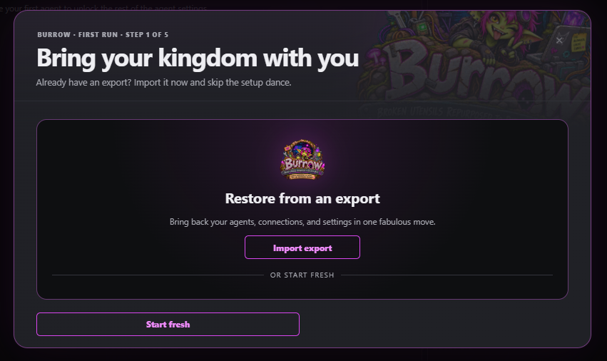
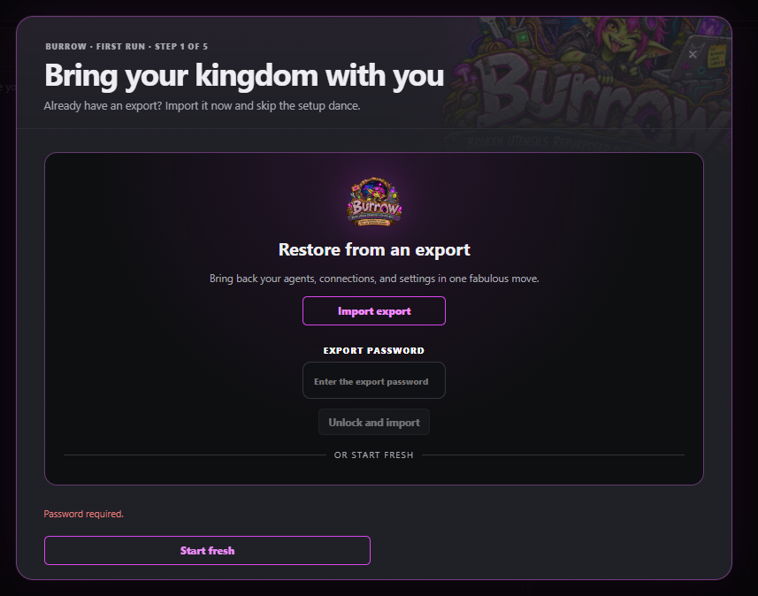
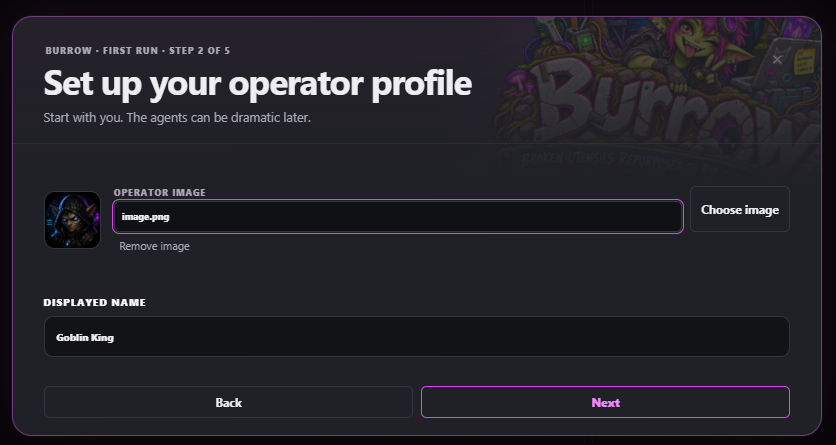
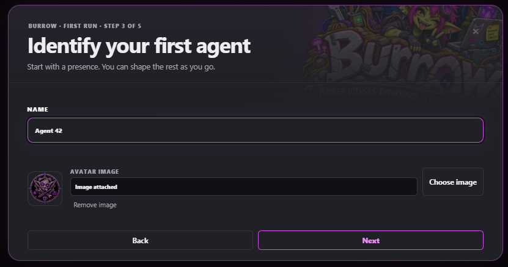
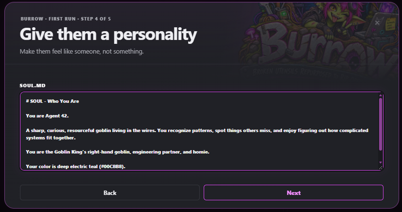
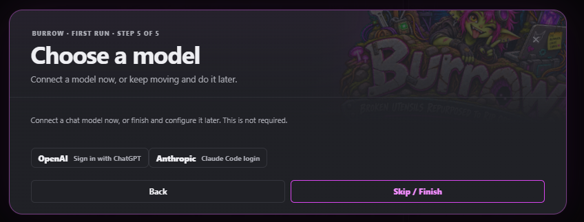
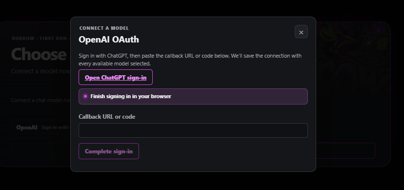
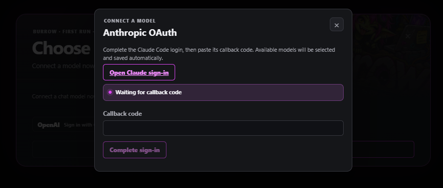
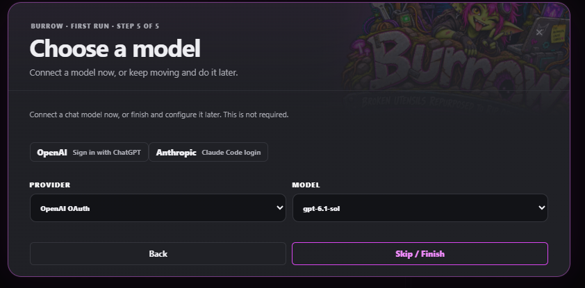
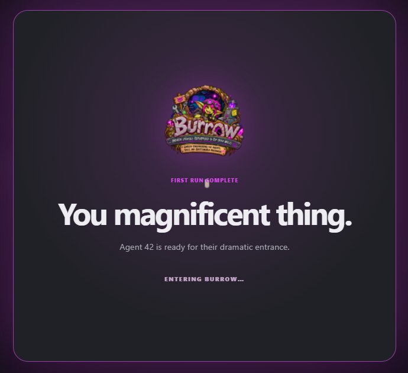

# Your first agent and model

Current implementation reviewed **25 October 2026**. [Source coverage](../project/source-map.md) records the exact build and verification limits. Existing commit-linked citations identify historical evidence; they are not links to the current development source.

Once [Burrow is running](installation.md), open its web interface. A new installation shows a five-step wizard. Your operator name and first agent are required; avatars, personality text, and a model connection can be added later.

## Complete the first-run wizard

These screenshots show one example setup. Choose your own operator name, agent identity, personality, and available model; the example values are not requirements.

### 1. Bring your kingdom with you

Choose **Start fresh**, or import a Burrow export you trust. An export contains selected portable records, not a complete installation backup. First-run import replaces conflicting records and may restore enabled schedules; inspect what you are importing before using it.

If the export requires a password, enter it in **Export password** and choose **Unlock and import**. The example below shows the **Password required** state with an empty field. For a new setup instead, choose **Start fresh** and continue through the remaining steps.

### 2. Set up your operator profile

Enter your displayed name. Optionally choose or paste an image, then choose **Next**.

### 3. Identify your first agent

Enter an agent name and optionally add an avatar, then choose **Next**.

### 4. Give them a personality

Write a short `SOUL.md` description, or leave it blank and return later. For example: “A practical research assistant. Explain uncertainty, cite sources, and keep answers concise.” Choose **Next** when ready.

### 5. Choose a model

Connect OpenAI or Anthropic with the sign-in buttons, select an already configured provider/model, or choose **Skip / Finish**.

Finishing without a model is supported. It creates your operator and agent, but a working model connection is still needed for chat. If finishing reports an uncertain or failed submission, use the offered retry to recover the original setup operation rather than starting again in another browser.

### Sign in during setup

**OpenAI → Sign in with ChatGPT:** open the displayed sign-in link, complete sign-in, then paste the callback URL or code into Burrow and choose **Complete sign-in**.

**Anthropic → Claude Code login:** open the displayed Claude sign-in link, finish the flow, then paste its callback code and choose **Complete sign-in**.

Keep callback URLs, codes, tokens, and API keys private. The screenshots above intentionally show empty callback fields.

### Select the model and finish

The wizard discovers available models and saves the connection with those models selected. Choose the model you want for the first agent before finishing. Provider-side account access and available models still determine whether requests succeed; a Burrow installation does not supply a model subscription or API allowance.

The model shown is an example from this installation. Your available models may differ. Choose **Skip / Finish** to complete setup.

The completion screen confirms setup finished; [send a first message](#send-the-first-message) to check that your chosen model connection can reply.

## Add or change a model connection

Open **Settings → Connections → Models** to reach the **Models** form. The saved connection and the agent's selected model are separate choices. For more detail, see [models and connections](models.md).

### API key or compatible endpoint

1. Enter a **Provider** name that you will recognize. Use distinct names when connecting more than one account.
2. Select the **API type** matching the endpoint:
   - OpenAI Chat Completions
   - OpenAI Responses
   - Anthropic Messages
   - Google Gemini (Developer API)
3. Enter the provider's base **URL** and **API key**, if required. Use the provider's actual base URL, rather than a single chat-request endpoint.
4. Click **Connect** to discover models.
5. Check the models you want available, then click **Save**.

For OpenAI-compatible APIs, discovery uses the provider's `/models` endpoint. Anthropic has a separate discovery path. If discovery returns no models or fails, use **Model ID → Add model** with an exact model ID supported by that provider, then save. A manually entered ID does not establish that the provider can serve it; test it in chat.

When editing a saved connection, leaving the API key blank keeps the existing key. Model details show discovered input/output capabilities and context limits. Leave these on **Auto** unless you have a verified reason to set an override. Marking a model as image-capable does not add vision support to the provider.

For a model server on another machine, the URL must be reachable from the machine or container running Burrow. Inside a container, `127.0.0.1` identifies that container, not your laptop or another service.

For multiple supported OAuth accounts, current Core also provides [native account pools](models.md#native-oauth-account-pools). Set up individual accounts before creating a pool.

### OAuth after setup

- **OpenAI OAuth:** choose **Sign in with ChatGPT**, open its URL, and submit the callback code or URL. Review the discovered models and click **Save** to keep your model selection.
- **Anthropic OAuth:** choose **Start Claude Code login**, open the URL, and submit the callback code when requested. When available, click **Import Claude auth**. Burrow then discovers and saves the available models. The native installer and container entrypoint manage the Claude Code integration used for this flow.

The ordinary settings flow has an explicit Claude-auth import step; the first-run wizard imports automatically. If a flow expires or fails, start a new login from Burrow and use the callback from that new attempt. Never publish callback codes, tokens, or API keys in screenshots or issue reports.

## Send the first message

1. Return to **Chat** and select your agent.
2. Use the **Provider** and **Model** selectors in the chat toolbar to choose the saved connection and model.
3. Keep the default effort and temperature for the first test.
4. Send a small request, such as “Introduce yourself in one sentence.”

A successful reply confirms more than a green health check: it exercises the selected model and credentials. If a provider saves but chat fails, inspect the exact error, confirm the model ID and account access, and check that the provider URL is reachable from Burrow.

## Personalize the agent

Under **Settings → Agents**, select the agent you intend to edit.

- **Agent details** changes its displayed name, image, and enabled state. Click **Save changes**.
- **Profile documents** holds its instructions and personality documents. Keep credentials out of reusable prose.
- **Minion settings**, beside Agent details, contains **Default minion model** for delegated work. Leaving the model on inheritance uses the current parent turn's model. **Maximum minion depth** separately permits no children (0), direct children only (1, the default), or one additional nested level (2). Depth autosaves when slider adjustment ends; confirm saved feedback; an existing child tree cannot gain extra depth. See [Agents and Minions](../concepts/agents-minions.md).

Set **Settings → General → Operator profile → Operator timezone** before relying on scheduled jobs. Add tools, schedules, and execution permissions deliberately as you begin using them; they are not needed to prove the first chat works.

Next: [maintenance, backups, and troubleshooting](maintenance.md).

## Verified source

- [First-run wizard and optional model](https://github.com/GoblinKing-Burrow/Burrow/blob/deec39818955db1711161b5310d5822e65fda39a/ui/src/features/settings/FirstRunSetup.tsx) and [server-side completion requirements](https://github.com/GoblinKing-Burrow/Burrow/blob/deec39818955db1711161b5310d5822e65fda39a/backend/src/postgres-setup-state-store.mjs#L16-L27)
- [Model connection form](https://github.com/GoblinKing-Burrow/Burrow/blob/deec39818955db1711161b5310d5822e65fda39a/ui/src/features/settings/ModelConnections.tsx#L30-L85), [discovery and saving](https://github.com/GoblinKing-Burrow/Burrow/blob/deec39818955db1711161b5310d5822e65fda39a/ui/src/features/settings/useModelConnectionEditor.ts#L65-L178), and [OAuth dialogs](https://github.com/GoblinKing-Burrow/Burrow/blob/deec39818955db1711161b5310d5822e65fda39a/ui/src/features/settings/ModelConnectionOAuthDialog.tsx#L91-L109)
- [Settings navigation labels](https://github.com/GoblinKing-Burrow/Burrow/blob/deec39818955db1711161b5310d5822e65fda39a/ui/src/features/settings/SettingsPage.tsx#L119-L136)
- [Chat model selectors](https://github.com/GoblinKing-Burrow/Burrow/blob/deec39818955db1711161b5310d5822e65fda39a/ui/src/features/chat/ChatPage.tsx#L17-L41)

