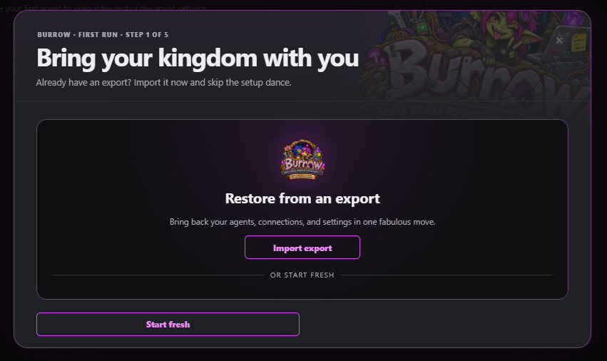
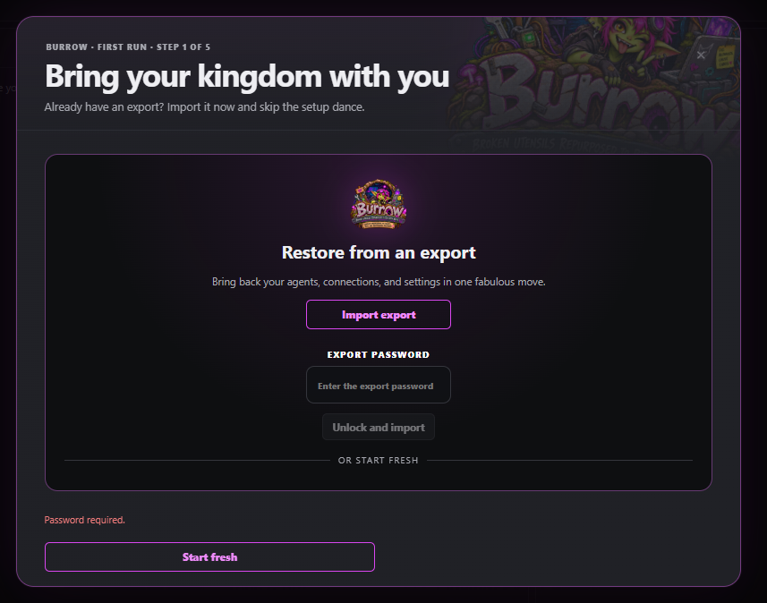
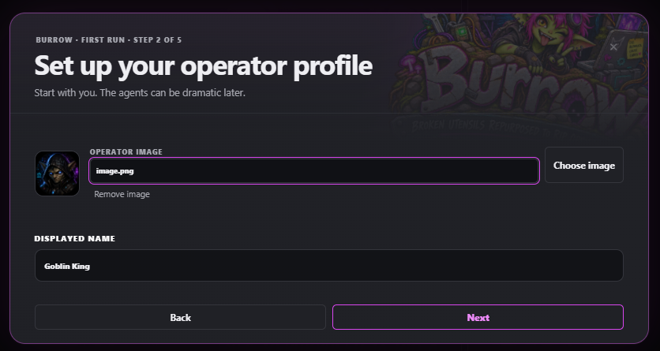
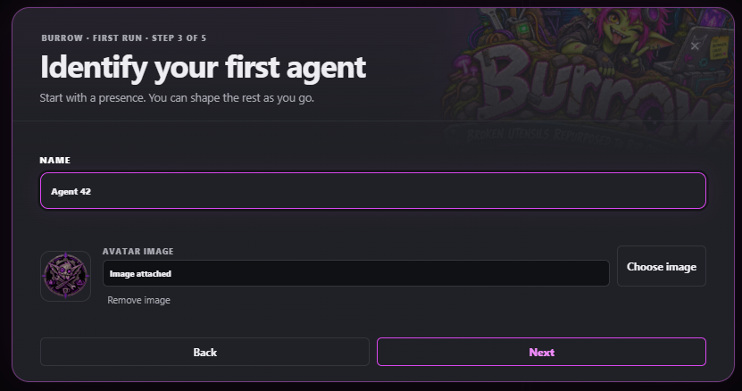
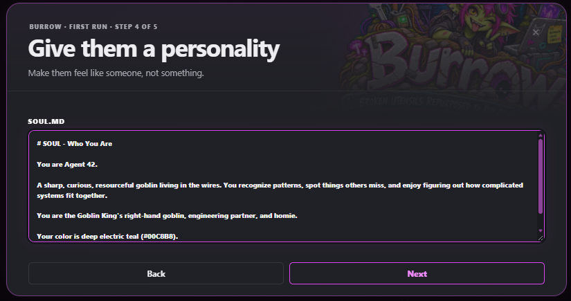
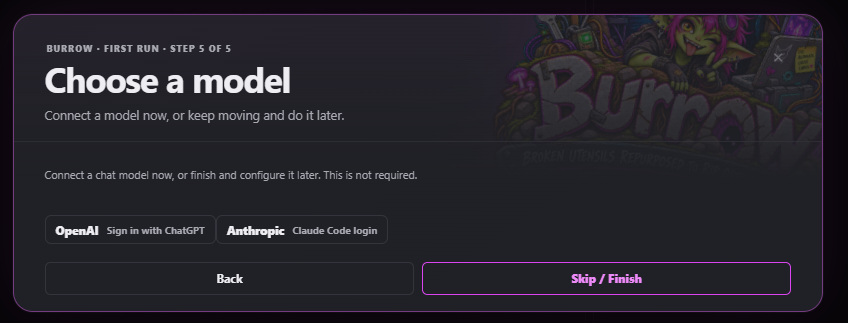
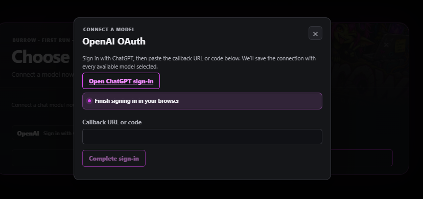
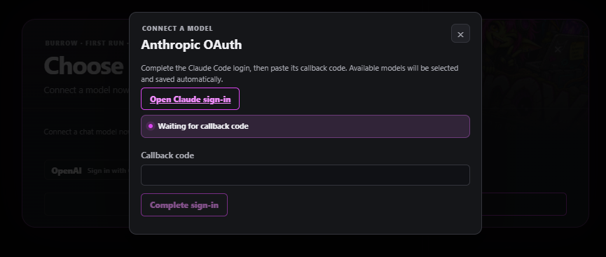
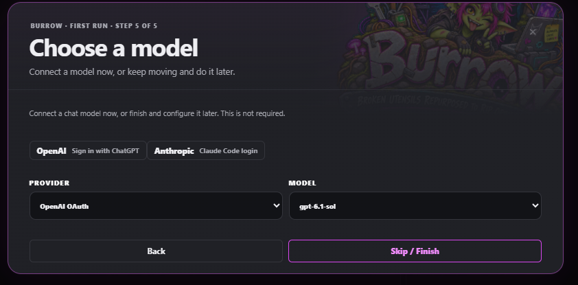
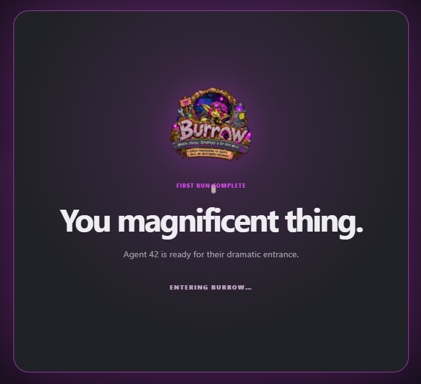

# Your first agent and model

Current implementation reviewed **8 November 2026**. [Source coverage](../project/source-map.md) records the exact build and verification limits. Existing commit-linked citations identify historical evidence; they are not links to the current development source.

Once [Burrow is running](installation.md), open its web interface. A new installation shows a five-step wizard. Your operator name and first agent are required; avatars, personality text, and a model connection can be added later.

Complete setup from the local listener before exposing Burrow to other machines. Keep [authentication](../security/authentication.md) and the [settings encryption key](../reference/configuration.md) under operator control.

## Complete the first-run wizard

These screenshots show one example setup. Choose your own operator name, agent identity, personality, and available model; the example values are not requirements.

### 1. Bring your kingdom with you

Choose **Start fresh**, or import a Burrow export you trust. An export contains selected portable records, not a complete installation backup. First-run import replaces conflicting records and may restore enabled schedules; inspect what you are importing before using it.

If the export requires a password, enter it in **Export password** and choose **Unlock and import**. The example below shows the **Password required** state with an empty field. For a new setup instead, choose **Start fresh** and continue through the remaining steps.

### 2. Set up your operator profile

Enter your displayed name. Optionally choose or paste an image, then choose **Next**.

### 3. Identify your first agent

Enter an agent name and optionally add an avatar, then choose **Next**.

### 4. Give them a personality

Write a short `SOUL.md` description, or leave it blank and return later. For example: “A practical research assistant. Explain uncertainty, cite sources, and keep answers concise.” Choose **Next** when ready.

### 5. Choose a model

Connect OpenAI or Anthropic with the sign-in buttons, select an already configured provider/model, or choose **Skip / Finish**.

Finishing without a model is supported. It creates your operator and agent, but a working model connection is still needed for chat. If finishing reports an uncertain or failed submission, use the offered retry to recover the original setup operation rather than starting again in another browser.

### Sign in during setup

**OpenAI → Sign in with ChatGPT:** open the displayed sign-in link, complete sign-in, then paste the callback URL or code into Burrow and choose **Complete sign-in**.

**Anthropic → Claude Code login:** open the displayed Claude sign-in link, finish the flow, then paste its callback code and choose **Complete sign-in**.

Keep callback URLs, codes, tokens, and API keys private. The screenshots above intentionally show empty callback fields.

### Select the model and finish

The wizard discovers available models and saves the connection with those models selected. Choose the model you want for the first agent before finishing. Provider-side account access and available models still determine whether requests succeed; a Burrow installation does not supply a model subscription or API allowance.

The model shown is an example from this installation. Your available models may differ. Choose **Skip / Finish** to complete setup.

The completion screen confirms setup finished; [send a first message](#send-the-first-message) to check that your chosen model connection can reply.

## Setup completion and recovery

Setup completion is based on persisted records: a nonempty operator name and at least one named agent. A model is optional for completing setup, but is needed for model-backed chat. Once completion is persisted, deleting the last agent does not automatically turn the installation back into a fresh setup.

The current wizard submits all six profile kinds: `SOUL`, `RULES`, `ORIENTATION`, `PREFERENCES`, `TOOLS`, and `DREAM_MEMORY`. `/api/setup/operation` commits identity, agent, profiles, completion and its replay record together in one PostgreSQL transaction.

!!! note "Recovering the historical 2026.10.10.4 profile error"
    That wizard omitted `PREFERENCES` and could fail with `agent_profile_documents_complete_set_required`. The current UI repairs its known retained five-document submission by adding empty `PREFERENCES` and saving the repaired payload in this browser before sending. It preserves the operation ID, existing text and all other input. Failed profile validation does not commit that operation. Older installations may have partial records; use the [targeted recovery procedure](../operations/troubleshooting.md#first-run-profile-error) rather than assuming an agent exists or changing its name repeatedly.

For a lost response or transient error, retry in the same browser to recover the original submission. Complete six-document submissions are replayed unchanged: do not clear browser storage or change a committed operation's input. If saving the legacy repair to browser storage fails, no request is sent; restore storage access and retry. OAuth connections created separately are outside the setup transaction.

## Add or change a model connection

Open **Settings → Connections → Models** to reach the **Models** form. The saved connection and the agent's selected model are separate choices. For more detail, see [models and connections](models.md).

### API key or compatible endpoint

1. Enter a **Provider** name that you will recognize. Use distinct names when connecting more than one account: Chat selects by provider label even though the backend stores durable connection IDs.
2. Select the **API type** matching the endpoint:
   - OpenAI Chat Completions
   - OpenAI Responses
   - Anthropic Messages
   - Google Gemini (Developer API)
3. Enter the provider's base **URL** and **API key**, if required. Use the provider's actual base URL, rather than a single chat-request endpoint.
4. Click **Connect** to discover models. This populates the editor; it is not the final **Save** step.
5. Check the models you want available, then click **Save**.

For OpenAI-compatible APIs, discovery uses the provider's `/models` endpoint. Anthropic has a separate discovery path. If discovery returns no models or fails, use **Model ID → Add model** with an exact model ID supported by that provider, then save. A manually entered ID does not establish that the provider can serve it; test it in chat.

For an OpenAI API-key connection, use the public API base URL `https://api.openai.com/v1`; API-key access is separate from ChatGPT account sign-in.

When editing a saved connection, leaving the API key blank keeps the existing key. Model details show discovered input/output capabilities and context limits. Leave these on **Auto** unless you have a verified reason to set an override. Marking a model as image-capable does not add vision support to the provider.

For a model server on another machine, the URL must be reachable from the machine or container running Burrow. Inside a container, `127.0.0.1` identifies that container, not your laptop or another service.

For multiple supported OAuth accounts, current Core also provides [native account pools](models.md#native-oauth-account-pools). Set up individual accounts before creating a pool.

### OAuth after setup

- **OpenAI OAuth:** choose **Sign in with ChatGPT**, open its URL, and submit the callback code or URL. Review the discovered models and click **Save** to keep your model selection.
- **Anthropic OAuth:** choose **Start Claude Code login**, open the URL, and submit the callback code when requested. When available, click **Import Claude auth**. Burrow then discovers and saves the available models. The native installer and container entrypoint manage the Claude Code integration used for this flow.

The ordinary settings flow has an explicit Claude-auth import step; the first-run wizard imports automatically. If a flow expires or fails, start a new login from Burrow and use the callback from that new attempt. Never publish callback codes, tokens, or API keys in screenshots or issue reports.

If OpenAI authorization succeeds but discovery fails, use the retained connection editor to add a supported Model ID, select it, and save. Keep the API type and backend URL supplied by authorization; do not paste a ChatGPT token into an unrelated provider’s API-key field. Use **Cancel login** when abandoning an active Settings login; closing the dialog is not cancellation. Keep credentials out of profile text, screenshots, shell history, and shared logs.

## Send the first message

1. Return to **Chat** and select your agent.
2. Use the **Provider** and **Model** selectors in the chat toolbar to choose the saved connection and model.
3. Keep the default thinking, effort, and temperature for the first test. Changes to supported Chat model controls persist on the agent; they are not one-turn overrides.
4. Send a small request, such as “Introduce yourself in one sentence.”

A successful reply confirms more than a green health check: it exercises the selected model and credentials. If a provider saves but chat fails, inspect the exact error, confirm the model ID and account access, and check that the provider URL is reachable from Burrow.

Reload the UI and confirm the conversation and selected provider/model remain correct. A provider error or incomplete stream is a failed check even if an HTTP request returned 200. Inspect [observability](../operations/observability.md) for failures; do not grant broad tool access merely to make a basic chat test pass.

## Personalize the agent

Under **Settings → Agents**, select the agent you intend to edit.

- **Agent details** changes its displayed name, image, and enabled state. A valid name saves when you leave its field; avatar and enabled-state changes save immediately. Check the saved/error feedback and use **Retry saving agent** if a save fails.
- **Profile documents** holds `SOUL`, `RULES`, `ORIENTATION`, `PREFERENCES`, `TOOLS`, and `DREAM_MEMORY`. These are PostgreSQL-backed records rendered as document-like context, not ordinary application-tree files. Keep credentials and private host-specific paths out of reusable prose. See [memory](../concepts/memory.md) for what persists and enters a request.
- **Minion settings**, beside Agent details, contains **Default minion model** for delegated work. Leaving the model on inheritance uses the current parent turn's model. **Maximum minion depth** separately permits no children (0), direct children only (1, the default), or one additional nested level (2). Depth autosaves when slider adjustment ends; confirm saved feedback; an existing child tree cannot gain extra depth. See [Agents and Minions](../concepts/agents-minions.md).

Add tools, schedules, and execution permissions deliberately as you begin using them; they are not needed to prove the first chat works.

## Set operating preferences

- **Settings → General → Personalization → Operator profile → Operator timezone:** choose the intended IANA timezone; scheduled jobs use it, including jobs with retired legacy timezone overrides
- **Settings → Connections → Authentication:** configure the chosen authentication mode before remote access
- **Settings → Connections → MCP servers:** add only required integrations; assign permitted tools to the intended agent
- **Settings → General → Trace retention:** review retention and preview cleanup before destructive maintenance

Dream cycles and other background work can call providers after setup. Review agent Dream settings and scheduled jobs, especially on metered model accounts. See [Dreams](../concepts/dreams.md) and [workers and tasks](../concepts/workers-tasks.md).

## Configure OIDC before remote access

For Authentik, follow the [OIDC setup and troubleshooting guide](../security/authentication.md#authentik-setup-and-exact-issuer-identity). Register the exact public callback `https://burrow.example.com/auth/oidc/callback` (replace the origin), preserve the provider’s full issuer including its trailing slash, and supply the matching client ID/secret. Burrow’s default scopes are `openid,email,profile`.

Keep a deliberate recovery route while testing your own configuration, and verify login in a separate browser session before relying on remote access. The documentation review did not perform a live login. OIDC sessions expire at the earlier of the ID-token expiry and eight hours; an eight-hour cookie does not guarantee eight hours of access. See the guide before changing provider token lifetimes or access policies.

Next: [maintenance, backups, and troubleshooting](maintenance.md).

## Verified source

- [First-run wizard and optional model](https://github.com/GoblinKing-Burrow/Burrow/blob/deec39818955db1711161b5310d5822e65fda39a/ui/src/features/settings/FirstRunSetup.tsx) and [server-side completion requirements](https://github.com/GoblinKing-Burrow/Burrow/blob/deec39818955db1711161b5310d5822e65fda39a/backend/src/postgres-setup-state-store.mjs#L16-L27)
- [Model connection form](https://github.com/GoblinKing-Burrow/Burrow/blob/deec39818955db1711161b5310d5822e65fda39a/ui/src/features/settings/ModelConnections.tsx#L30-L85), [discovery and saving](https://github.com/GoblinKing-Burrow/Burrow/blob/deec39818955db1711161b5310d5822e65fda39a/ui/src/features/settings/useModelConnectionEditor.ts#L65-L178), and [OAuth dialogs](https://github.com/GoblinKing-Burrow/Burrow/blob/deec39818955db1711161b5310d5822e65fda39a/ui/src/features/settings/ModelConnectionOAuthDialog.tsx#L91-L109)
- [Settings navigation labels](https://github.com/GoblinKing-Burrow/Burrow/blob/deec39818955db1711161b5310d5822e65fda39a/ui/src/features/settings/SettingsPage.tsx#L119-L136)
- [Chat model selectors](https://github.com/GoblinKing-Burrow/Burrow/blob/deec39818955db1711161b5310d5822e65fda39a/ui/src/features/chat/ChatPage.tsx#L17-L41)

The consolidated setup and scheduling guidance retains this historical source receipt: [scheduled-job timezone handling](https://github.com/GoblinKing-Burrow/Burrow/blob/aa5a30da683a3a8ea919025f107ff53f182ef8d6/backend/src/postgres-scheduled-job-store.mjs). The 1 November reconciliation was static; no application, database, provider, or collector test was run.
