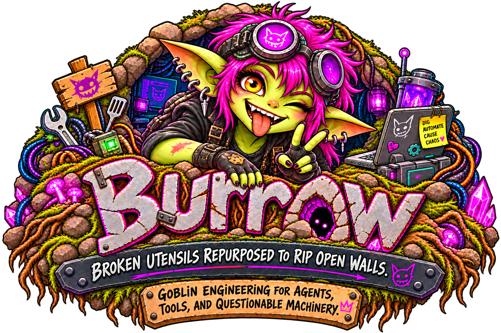

{ .burrow-hero-logo }

# Your agents. Your workbench.

Burrow is a self-hosted, chat-first AI agent application. Connect a model, give an agent a personality, and keep conversations, tools, memories, and project work in one place.

[Install Burrow](guide/installation.md){ .md-button .md-button--primary }
[Create your first agent](guide/first-agent.md){ .md-button }

Public-release guide · **2026.10.19**

## Start small. Add what you need.

You run Burrow on your own host and open its web interface in a browser. Model providers and integrations may still receive the content you send them; self-hosted does not mean every model runs locally.

- **Have your first conversation**

    Install Burrow, finish the setup wizard, connect a model, and send a harmless first message.

    [Start here →](guide/installation.md)

- **Make it your everyday workspace**

    Switch agents and sessions, follow running work, use files, and find past conversations.

    [Learn the interface →](guide/everyday-use.md)

- **Give agents useful capabilities**

    Understand model connections, MCP tools, Node Goblin, skills, and optional mods before enabling them.

    [Choose tools and mods →](guide/tools-and-mods.md)

- **Keep your work safe**

    Update deliberately, protect your database and encryption key, and know what to check when something fails.

    [Maintenance and help →](guide/maintenance.md)

!!! warning "Understand the access you grant"
    Burrow does not provide comprehensive guardrails around agent actions. Tools and mods can access files, credentials, remote systems, and external services. Start on loopback, use least-privilege credentials, and enable only integrations you trust. An agent workspace is not a security sandbox.

## A guide to the public release

These user guides follow [GoblinKing-Burrow/Burrow](https://github.com/GoblinKing-Burrow/Burrow/tree/deec39818955db1711161b5310d5822e65fda39a), not the moving NightShaman development build. Features depend on your installed release, model provider, and enabled mods.

Older architectural and API material remains under **Earlier technical reference**, with a warning on every page. It is not a second set of current installation instructions. [Read the source and verification scope](project/source-map.md).

Burrow is distributed under its [Sustainable Use License](https://github.com/GoblinKing-Burrow/Burrow/blob/deec39818955db1711161b5310d5822e65fda39a/LICENSE).
