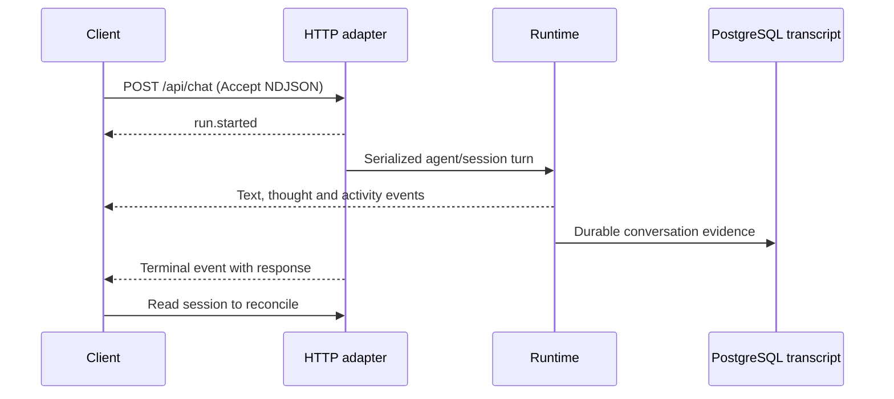

# Chat and streaming

!!! note "Source-reviewed API reference"
    This reference was reconciled against current development source on **2026-10-25**. Historical public-source links below remain pinned to their stated revision; they are not proof that a public mirror or your installation has caught up. Start with the [current operator guide](../../guide/installation.md) for installation. This is static source review, not a live API compatibility test.

`POST /api/chat` submits one user-visible turn. Select an existing agent; its configured model and tools determine what the turn can do. A request can incur provider charges and execute granted tools.

## Request body

| Field | Behavior |
|---|---|
| `agentId` | Registered agent; explicit selection is recommended |
| `sessionId` | Session name, default `default` |
| `message` | Nonblank string; an image attachment permits an image-only request |
| `runId` | Optional caller-supplied run identifier; absence generates one, not a general idempotency key |
| `attachments` | Array of `{name, type, size, encoding, content}` records |
| `modelConnectionId`, `model` | Optional exact enabled connection/model overrides |
| `reasoningEffort`, `temperature` | Per-turn generation preferences, subject to model support |
| `continuityScope` | Explicit continuity namespace; `workingProject` is a compatibility alias |
| `noCallModel` | Literal `true` selects no-model behavior; not an authorization or sandbox control |

Normal chat does not accept a workspace-selection/execution-target protocol. A continuity namespace or prose path does not change the tool cwd or execution target. Ordinary main-turn admission is serialized, but busy submissions are rejected rather than implicitly accepted as queued turns; use the explicit inputs below. `/stop`, `/new`, and `/status` bypass that wait so cancellation, reset and status can reach an active turn.

### Attachment and request budgets

The browser defaults to **8 MiB per file**, **16 MiB per attachment batch**, and **8 files**. These are pre-read browser resource budgets, not server admission policy. Deployments can override positive integer values through `window.__BURROW_CLIENT_BUDGETS__` before loading the UI bundle. 

The server separately truncates non-image attachment content to 200,000 characters and rejects image content above 30,000,000 characters with 413. Its JSON request reader defaults to **96 MiB** total body bytes and **30 seconds** for body receipt; `BURROW_REQUEST_MAX_BYTES` and `BURROW_REQUEST_TIMEOUT_MS` configure those ceilings. JSON traversal is also bounded. None of these limits proves native PDF/Office parsing from a filename or guarantees that all attachment text reaches the model.
## NDJSON protocol

Send `Accept: application/x-ndjson` to receive newline-delimited JSON over the POST response. The response uses HTTP 200 and `application/x-ndjson; charset=utf-8`, with `no-cache, no-transform` and `x-accel-buffering: no`. It is not Server-Sent Events.

Each event has `type`, `runId`, `sessionId`, `ts` and `data`. Buffer partial network chunks until a complete line is available, parse each JSON line independently and ignore unknown event types safely.

| Event | Meaning |
|---|---|
| `run.started` | Accepted runtime turn and run identifier |
| `route.decided` | Route/session-kind observation |
| `model.started`, `model.completed` | Model request/response metadata |
| `model.recovery` | Nonterminal bounded recovery state for a model request |
| `assistant.delta` | Provisional answer text; `data.delta`, `totalChars`, `modelCall` |
| `assistant.thought` | Separate provisional thought stream; never merge it into the final answer |
| `tool.started`, `tool.completed` | Tool activity/status and selected presentation fields |
| `verification.completed` | Verification observation |
| `runtime.notice` | Runtime loop warning/block notice |
| `context.compaction.started`, `.completed`, `.failed` | Bounded compaction lifecycle/receipt; a safe no-op completes with `compressed: false` |
| `run.completed` | Terminal `data.response`; inspect its application outcome |
| `run.failed`, `run.cancelled`, `run.superseded` | Other terminal outcomes with `data.response` |

The terminal response and persisted transcript are authoritative, not accumulated deltas. A handled unsuccessful result can arrive in `run.completed`, and an HTTP 200 stream can end with failure. Slash-command turns can produce only a terminal event. Early validation failures can be ordinary JSON errors before streaming starts.

Tool progress is operational evidence, not a content-free telemetry guarantee: projected fields can include command, cwd, paths, query, reason and error. Keep streams private.

## Model recovery and receipts

Current development emits nonterminal `model.recovery` events with states `recovering`, `resumed`, `exhausted`, `blocked`, `requires_investigation` or `cancelled`. Continue reading for the terminal run event. On a replacement attempt, `modelCall` identifies a new active provisional answer; discard the abandoned partial answer instead of concatenating attempts.

Terminal responses and retained assistant metadata can include `modelFailure` (origin, code, retryability and observed upstream HTTP status) and `modelRecovery` (`version: 1`, `retryCount`, bounded `requests`). At most 32 request summaries retain attempt limits, original/last failure, safe failover blocker and partial character counts—not raw prompts, provider bodies, thoughts, tool payloads or headers. The original upstream failure remains distinct from a recovery/failover failure.

Defaults are three physical dispatch attempts per request and four extra attempts across the run, with cancellable one/three-second waits. The wrapper does not replay completed tools or the whole turn, and does not promise exactly-once provider billing or resume a broken byte stream. Active/child/task projections remain active while recovery or cancellation drains. See [runtime recovery boundaries](../../architecture/runtime.md#bounded-live-model-recovery) and [troubleshooting](../../operations/troubleshooting.md#recovering-exhausted-or-blocked-model-requests).

## Manual compaction

Send `/compact` as the ordinary chat message to run the existing compression planner without main-agent inference. It uses normal session admission, so it is not a bypass of busy-session rejection. Originals remain archived; empty or irreducible history produces a reported no-op, not a reset. Manual NDJSON begins before the work; its feedback is retained in visible history but excluded from model input. Inspect the terminal receipt and `compressed`/`reason`, not merely a started event. Compression does not guarantee that oversized immutable/current input will fit.

## Disconnect and cancellation

After admission, closing the browser or aborting the client fetch marks the turn detached; it does not automatically cancel execution. A disconnect while still waiting for session admission aborts that queued request instead. Send `POST /api/chat/{runId}/cancel` with the owning `agentId` and optional `reason` for explicit cancellation. Cancellation is a request to stop active work, not rollback of tools already executed. Current source also propagates Stop into compaction database checkout/owned-query cancellation and waits for safe drain or durable fencing before another write-capable owner proceeds. A cancelling run can remain visible during that drain; reset generation checks fence stale writes.

After a disconnect, query `GET /api/chat/runs/active` with `agentId`/`sessionId`, then reload [session history](sessions.md). Active-run state is in memory and is not a durable streaming replay cursor. There is no automatic resumption of the same event stream. Avoid blindly reposting a turn, which can run it twice.
## Steering an active turn

`POST /api/chat/{runId}/steer` submits new user input to a run. Supply its owning `agentId`, exact `sessionId`, a nonblank `idempotencyKey`, and `message` (or supported image attachment input). `GET /api/chat/{runId}/steering?agentId=...&sessionId=...` reads the durable submissions and their status. Both routes use the normal API authentication boundary.

| Status | Meaning |
|---|---|
| `pending` | Stored, waiting for a runtime boundary |
| `delivered` | Handed into the model continuation and recorded for prompt replay |
| `follow_up` | Run stopped accepting input before delivery; not automatically sent as a new turn |

A successful POST confirms storage, not delivery or completion of the requested work. Poll steering status and inspect the resulting transcript. Inputs are delivered at runtime boundaries; steering does not undo a tool already executed. Reuse an idempotency key only for an identical retry: changed payloads return 409 `steering_idempotency_conflict`. A reset generation mismatch returns 409 `chat_run_session_reset`; an unknown run returns 404 `chat_run_not_found`. Stopping the run or recovering after the server no longer has it active can leave input marked `follow_up`; review it before explicitly sending a new turn to avoid duplicated work.
## Explicit inputs while chat is busy

Ordinary `POST /api/chat` now rejects a busy main session, or a session with queued/held/running main inputs, with **409 `chat_session_busy_use_explicit_intent`**. That is not acceptance. Choose explicitly between steering the existing run, queueing a new turn, or asking a side question.

| Method | Path | Result |
|---|---|---|
| `GET` | `/api/chat/inputs?agentId=...&sessionId=...` | `{ok, generation, inputs}` for the current reset generation, in acceptance order |
| `POST` | `/api/chat/inputs` | 202 `{ok, input}` for durable acceptance or an identical retry |
| `POST` | `/api/chat/inputs/{inputId}/cancel` | Current input state; a running cancellation can remain `running` with `cancelRequested: true` |
| `POST` | `/api/chat/inputs/{inputId}/resume` | Selected input plus all held main inputs changed to queued |

Submission needs `intent: "queue_next"` or `"side_question"`, a nonblank `idempotencyKey`, and message or supported attachment input. Supply `agentId`, `sessionId`, and the current `generation` from GET. Actions use the input UUID, not its generated run ID. The key binds normalized payload and generation: identical retries return the original input/snapshot; changed payloads return `chat_input_idempotency_conflict`. A stale generation returns `chat_input_generation_conflict`; reread before acting rather than silently retrying after reset.

- **Queue next:** durable FIFO new main turns, dispatched independently of the browser. Completion or failure allows the next eligible item; owner loss records interrupted work rather than automatically repeating side effects.
- **Side question:** additionally requires the exact active main `targetRunId`. It answers from a frozen bounded snapshot in one tool-free model call; no commands, fresh inspection, or interruption of the main run. Historical attachment contents are not replayed. Snapshot context is not fresh verification. Side answers do not automatically enter main context/continuity.
- **Promote deliberately:** edit the desired instruction and submit a new queue input or live steer with `promotedFrom` set to a succeeded side-question input UUID from the same agent/session/generation. This records provenance; it does not copy the answer automatically.

Statuses are `queued`, `held`, `running`, `succeeded`, `failed`, `cancelled`, and `interrupted`. Acceptance is not completion: poll the retained result/error. Input responses include submitted message and attachment contents; protect them. Side snapshot responses expose only metadata, not the captured raw transcript/profile. Active-run projections distinguish `lane: main|side_question` and optional `inputId`.

Stop of the main run, `/stop` even when idle, or cancellation of a running queue turn holds current **and future** main queue entries. Resuming a held item releases **all** held entries in FIFO order; it does not restart cancelled work. Cancelling a queued/held item cancels that item; cancelling a side question does not hold the main queue. `/new`/reset advances generation and fences old work/results.

## Endpoint inventory

Methods are significant. Braced segments are placeholders; URL-encode identifiers. See the [contract and conventions](../api.md) for artifact limitations.

| Method | Path | Purpose |
|---|---|---|
| `POST` | `/api/chat` | Run one chat turn |
| `GET` | `/api/chat/runs/active` | List active chat runs |
| `POST` | `/api/chat/{runId}/cancel` | Cancel a chat run |
| `POST` | `/api/chat/{runId}/steer` | Submit idempotent steering input |
| `GET` | `/api/chat/{runId}/steering` | Read durable steering input/status |

## Source review

Reconciled on **2026-10-25** against Backend commit `3bf50374d3601c821e787912d52b9044eaf649ec`; static source inspection only, with no live API or provider calls.

## 27 October delta review

Changed contracts checked statically against Backend `32ff99dfc0317635f5c7aa53b4c9ec18266d4c09` on **2026-10-27**. This does not recertify unchanged historical sections or report live API/provider tests.

## 28 October development delta

Changed behavior above was checked statically against Backend `a04acb16b0eab2a910c3ef0fb452622df81a05cb` on **2026-10-28**. This is not a live provider, database or collector test, nor a revalidation of unchanged historical sections. See [source coverage](../../project/source-map.md).
